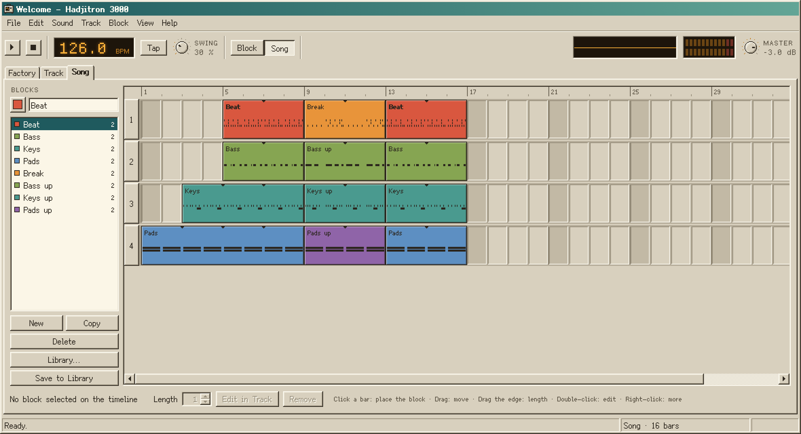
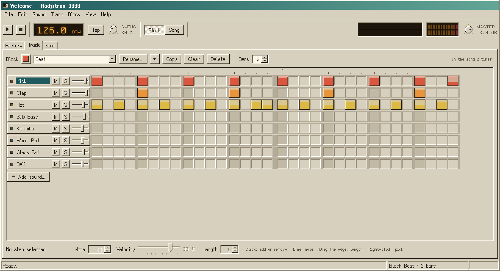
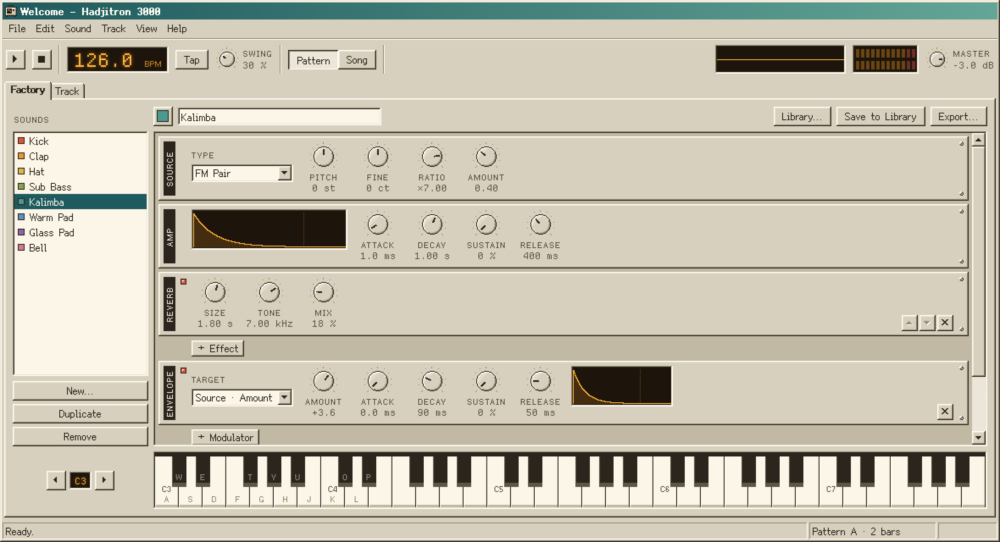
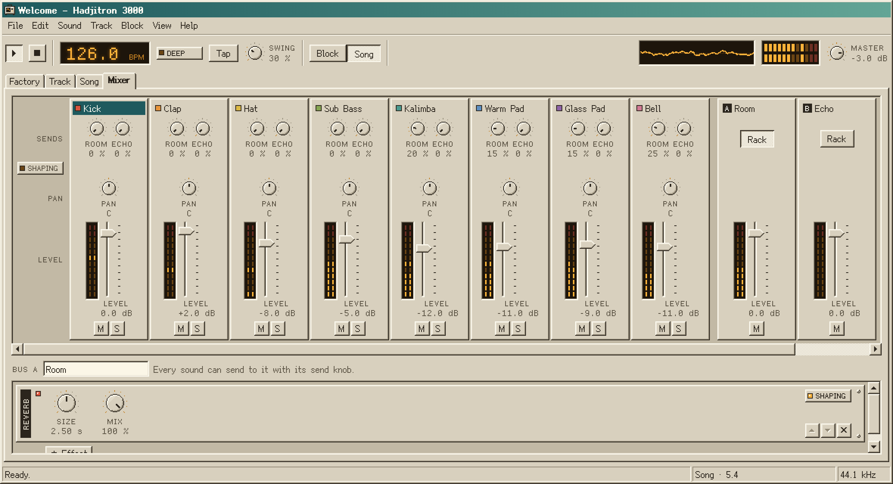

```
+==========================================================================+
|                                                                          |
|   H   H   AAA   DDDD      J  III  TTTTT  RRRR    OOO   N   N             |
|   H   H  A   A  D   D     J   I     T    R   R  O   O  NN  N             |
|   HHHHH  AAAAA  D   D     J   I     T    RRRR   O   O  N N N             |
|   H   H  A   A  D   D  J  J   I     T    R  R   O   O  N  NN             |
|   H   H  A   A  DDDD    JJ   III    T    R   R   OOO   N   N   3 0 0 0   |
|                                                                          |
|   a small music machine                                 version 0.1.0    |
|                                                                          |
+==========================================================================+
```

Hadjitron 3000 is a small music machine for electronic and experimental music. You build sounds in the Factory, write short blocks of steps with them on the Track, arrange the blocks into a song in the Song, balance them in the Mixer, press Space, and export what you made. It looks and behaves like a program from 1998 on purpose.









```
+--------------------------------------------------------------------------+
|  1. INSTALLATION ON A MACINTOSH                                          |
+--------------------------------------------------------------------------+
```

You need Node.js 22 or newer and the GitHub command line tool. If you use Homebrew:

```
brew install node gh
gh auth login
```

Answer yes when `gh auth login` asks whether to log in Git with your GitHub credentials; that is how the program later fetches its updates. Then fetch the program and put it in your Applications folder:

```
gh repo clone stases/Hadjitron3000
cd Hadjitron3000
npm install
npm run app
```

The first `npm install` downloads Electron and takes a minute or two. `npm run app` builds Hadjitron 3000.app and copies it to Applications, from where it opens like any other program: from Launchpad, Spotlight or the Dock. A demo called Welcome is loaded the first time; press Space to hear it.

The first time, a small window also offers two tutorials, Make a Sound and Make a Song. Each one walks you through the program a step at a time: a little window points at the control it talks about, ticks the step off when you have done it, and waits for you to press Next. A tutorial starts on a fresh project after offering to save yours, you can close it whenever you like, and both stay in the Help menu.

The application remembers the Hadjitron3000 folder it was built from, so leave that folder where it is. To update, choose Check for Updates in the Help menu. It asks GitHub what is new and lists the changes; Update and Restart fetches them into that folder, builds the new application, offers to save your project and opens the new version in place of the old one. Your sounds and blocks in Documents/Hadjitron 3000 and your saved projects are never touched. If something goes wrong on the way, the old version keeps working and the full story is in `update.log` in `~/Library/Application Support/Hadjitron 3000`.

The application is not signed by Apple. A copy you built yourself opens normally; a copy that was downloaded or sent to you has to be opened once with a right-click and Open. `npm run dist` makes a disk image in the `release` folder for giving the program to someone else.

```
+--------------------------------------------------------------------------+
|  2. THE TRACK                                                            |
+--------------------------------------------------------------------------+
```

Every sound of the project is a row, and every column is a sixteenth note. Click a cell to put a step there and click it again to remove it. Hold the button and move sideways to paint several steps. Drag a step up or down to change its note, drag its right edge to make it longer, and turn the scroll wheel over it to make it louder or softer. A right-click selects a step without changing it, and the bar at the bottom then shows its note, velocity and length.

The grid shows one block: one to thirty-two bars of steps for any of the project's sounds. The bar above the grid chooses the block to work on and gives it a colour and a name. Next to that are buttons to add a new block, copy the current one to start a variation, clear it and delete it, and the length of the block in bars. At the right end a quiet line tells you how often the block is used in the song.

Tempo, swing and the master volume are in the bar at the top of the window, and so is the time signature, which sets how many beats a bar of every block has: 4/4 as most music, 3/4 for a waltz, 7/8 or 5/8 for an odd, limping groove, 6/8 or 12/8 for a rolling one, and a few more. The grid groups the steps of a bar into its beats, so a bar of 7/8 shows fourteen steps as four, four and six. Changing it leaves every note where it is and makes each block as many bars of the new kind as it needs to keep all its notes. In beginner mode it sits behind a small Deep button next to the tempo, whose lamp lights when the song is not in 4/4. The Block and Song buttons next to them choose what Play plays: the current block over and over, or the whole song. The Track plays the block and the Song plays the song, so you rarely need to touch them.

To play a part in by feel, press Rec (or R) while the block plays: everything you play on the selected sound, on the computer keyboard, the piano in the Factory or a MIDI keyboard, is written into the block where you played it and for as long as you held it, and you hear it back on the next time round. Press Rec while stopped and a bar of clicks counts you in first. The lamp on the button blinks on the beats of the count-in and stays lit while recording; Rec or Stop ends it, and each time through from start to end is one step of Undo. Notes still held when the block comes round are cut at its end, and a note on the same beat and pitch as one already there is left out. The box next to Rec moves what you record onto a grid, sixteenths by default, or thirty-seconds, eighth or sixteenth triplets (1/8T and 1/16T), or leaves your timing as it is with Off; with swing, notes go to where the swung grid is heard. Recording works on a block, so Rec is greyed out while the song plays. The button with the metronome on it (or C) clicks every beat while playing, higher on the first beat of the bar; the clicks are only for you and never end up in an export, and the program remembers whether you want them.

A MIDI keyboard plugged in, before or while the program runs, plays the selected sound just like the computer keyboard, as softly or as hard as you play, and its sustain pedal holds the notes. The small MIDI lamp next to the scope blinks with every note, and the status bar names the keyboards it hears when the pointer is over it. In a browser this works where the browser offers MIDI, after you allow it, and the browser makes no sound until you have clicked somewhere in the page once.

Each row has a mute button, a solo button and a level slider. Double-click the name of a row to open that sound in the Factory. Drop audio files anywhere on the window to add them as new rows.

For chords, pads and notes between the steps, open a row in the piano roll with the small keyboard button on its header, or double-click a step that holds a chord. The roll takes the place of the grid, with a thin strip of every row above it so you can see the rest of the block and click another sound to switch to it. Pitch runs up the keys at the left (click one to hear it) and time runs across in the same columns as the grid. Click empty space to add a note and keep the button down to drag out its length; click on the same beat at another pitch to build a chord. Drag a note to move it, drag either end to make it start earlier or later or to change its length, and drag the bars in the amber lane at the bottom to set how hard each note plays. A click selects a note, Shift-click adds more, and dragging with Shift or the right button selects everything inside the rectangle; moving, the arrow keys, Delete and the bar at the bottom act on the whole selection. Snap sets the grid the notes stick to (sixteenths, thirty-seconds, two kinds of triplets, or off), and holding Alt while you drag ignores it. Copy puts a small teal mark in the ruler right after the copied notes and Paste puts them there, moving the mark on, so pasting again lays the copies end to end; click the ruler to put the mark somewhere else. Repeat (Cmd+D) copies the selection directly after itself. The Grid button or Esc goes back to the step grid, which shows the same notes.

A note can do more than sound once. Chance makes it play only on some of the times the block comes round, at the percentage you set, which keeps a hi-hat or a bleep from repeating itself exactly; the choice is the same every time you play the song, and in an export. Ratchet plays it two, three, four, six or eight times in quick succession inside its own length, for drum rolls and stutters. Slide lets the pitch glide into the note from the one before it on the row, as on an acid bass line. Hold turns a note into a drone: it keeps sounding to the end of its place in the song, without starting again when the block repeats there, and to the end of the block while the block plays on its own. Select one or more notes, in the grid or the roll, and set these in the bar at the bottom; in beginner mode Chance, Slide and Hold wait behind the Shaping button at its right end and Ratchet behind Deep, and their lamps light when a selected note uses one. Notes show what they do without being selected: a dithered note plays only sometimes, small ticks along its bottom are a ratchet, a slanted line at its left is a slide, and an arrow at its right with a line to the end of the row is a held note.

A note can also lock up to two controls of its sound to values of its own: the one snare with a longer decay, the stab with its filter wide open, the hit panned hard left. Choose the control under Lock 1 or Lock 2, next to Ratchet (behind Deep in beginner mode), and set its value with the knob beside it; it starts at the value the sound has. A control inside the note, such as the filter, the pitch or the amp envelope, changes for that note alone, even in a chord. A control the notes share, such as an effect or the output, takes the locked value while the note sounds and goes back when it ends. A locked note has a small padlock at its top right. A lock beats automation while its note sounds. The notes an arpeggiator plays from a locked note, and the repeats of a row with a length of its own, keep its locks.

A row can have a length of its own. Drag the small ink marker at the end of a row to the left and the row plays only that many steps before it starts again, while the others go on: a five-step hat against a sixteen-step kick drifts against it and comes round again after five bars, the way patterns of Aphex Twin and Four Tet slide past each other. The steps after the marker are shaded and show the row's steps again where they will play; they cannot be edited, and a click on one takes you to the step it repeats. Notes you had written there stay in the row, struck out and silent, until you drag the marker out again. Every row starts again with the block, and the piano roll shows its row the same way, with the marker in its ruler. In beginner mode the markers appear once a block has such a row, or when you press the Deep button at the right end of the block bar, whose lamp lights while the block has one.

The piano roll can help you stay in key. Choose a scale in its toolbar, a root and one of eleven kinds (major and minor, the church modes, harmonic minor, the two pentatonics, blues and whole tone), and the rows of the notes outside it are shaded, the root's rows are the lightest, and its keys carry a small teal mark. The scale belongs to the project. Snap to scale, beside it and in the Track menu, makes the notes you add or drag in the roll, the steps you drag up and down in the grid, the notes you record and the ones you type into a step land on the nearest note of the scale; notes already there are never changed behind your back. Fit to Scale in the Track menu moves the notes of the row that are out of the scale, or only the ones selected in the roll, to their nearest scale note in one step of Undo.

Randomise, in the Track menu and the roll's toolbar, fills the row with notes for you: the whole row, or only the stretch you drag out along the roll's ruler. Density says how many of the grid positions get a note, Grid how far apart they are, Centre and Range where the pitches lie, always within the scale when the project has one, and Length and Velocity how much those vary. Ratchets and Chances, off at first, give some notes a ratchet or a chance of their own. Every result comes from the Seed: the same seed gives the same notes again, and New draws another. Replace takes out the notes already in the stretch first, Add keeps them. Apply writes the notes and leaves the window open, so you can press New or change something and Apply again until you like it; all of it together is one step of Undo. In beginner mode the scale and Randomise wait behind the Shaping button at the right end of the roll's toolbar, whose lamp lights when the project has a scale.

```
+--------------------------------------------------------------------------+
|  3. THE SONG                                                             |
+--------------------------------------------------------------------------+
```

The Song arranges blocks on a timeline of four lanes, counted in bars. Blocks in different lanes play at the same time, so the beat, the bass line, the keys and a pad can each have a lane of their own, and a block in one lane can start while another is still going.

The list at the left holds the blocks of the project. Pick one and click an empty bar of a lane to place it there. Drag a placed block to move it along its lane or into another lane, and drag its right edge to stretch it: a block placed longer than it is plays again from the start, and one placed shorter is cut off. Double-click a placed block to edit its steps on the Track, and right-click it for a small menu. With the timeline selected, Delete removes the selected block and the arrow keys move it.

Each lane has a small head at its left: an M button that mutes everything in the lane, and a level slider that makes the lane softer or louder, from silence at the far left to 6 dB above where it starts. A placed block can fade in and out. Fade in and Fade out in the bar under the timeline count whole bars: the block rises from silence over the first of its bars and falls back to silence over the last, along a smooth curve, and the tile draws its fades as ramps. You can also drag the small handles at the top corners of a tile into it. A drone held over sixteen bars with a four-bar fade at each end swells, holds and dies away, and a beat can creep in under a pad. Sounds..., in the same bar or in the tile's right-click menu, lists the sounds the block plays; untick one and it is silent in this tile only, so the beat without the hat needs no copy of the block. A tile draws the rows of the sounds it leaves out dotted. In beginner mode the fades and Sounds... wait behind the Shaping button at the right end of the bar, whose lamp lights when the selected tile has a fade or a silent sound, and only tiles that already fade show their handles. Lane levels, fades and silent sounds belong to the song: while the Track plays a block on its own, none of them apply, and Export Audio renders the song as you hear it.

Automation moves a control along the song: a filter that opens over sixteen bars, a reverb that grows for the last chorus, a sound that pans from left to right, the Room's level, a send or the master volume. Press + Automation under the lanes, pick a sound, a bus or Master, and then the control. The new row is a small amber display under the lanes, bar for bar with them. Click in it to add a point, drag a point to move it, and right-click it or press Delete to remove it. Points land on the beats; hold Alt to place them anywhere. Between points the control moves in a straight line, before the first point and after the last it holds still, and the status bar shows the value and the position while you drag. Each click or drag is one step of Undo, and the x at the left of a row removes the whole row. A knob or fader that a row moves has an amber ring and an amber readout; while the song plays it follows the row, and turning it does nothing until you stop, when it is back at the value you gave it. Automation is part of the song, so a block playing on its own on the Track ignores it, and Export Audio moves every control exactly as playback does. In beginner mode the rows and the button wait behind the Deep button under the lanes, whose lamp lights when the song has automation.

A project holds up to twenty-six blocks. A block can also travel to other projects. Save Block to Library in the Block menu keeps a block, together with the sounds it plays, in the folder `Documents/Hadjitron 3000/Blocks`, and the Block Library window lists it after the factory blocks: the eight blocks of the demo song and the blocks of the six example songs below, each group under the name of its song. Show, above the list, narrows it to one group. Audition plays a block once, at the tempo of your project, and Add to Project brings it into the project with any of its sounds the project does not have yet. The blocks of one song share its key, so they fit together in a project of your own as well.

Open Example in the File menu opens one of six short songs as a new project, after offering to save yours: one for each kind of music the program is made for, to listen to and take apart. Each is built from four to six blocks of one to eight bars, set out on the lanes of the Song, balanced in the Mixer with the Room and the Echo, and has its key set as the scale of the piano roll. Welcome, the demo, still opens on the very first launch.

| Example      | Tempo | Key        | Bars | What it shows                                                                              |
| ------------ | ----- | ---------- | ---- | ------------------------------------------------------------------------------------------ |
| Techno       | 130   | A minor    | 32   | A rumble kick that ducks a drone, hats by chance, dub stabs, a break that opens the drone  |
| Trance       | 138   | F minor    | 32   | A rolling bass, gated pad and arpeggio pumped by the kick, a supersaw lead, a breakdown    |
| Acid         | 128   | E Phrygian | 24   | Three acid lines with slides and accents, one on a row of seven steps                      |
| Experimental | 112   | D minor    | 24   | A crushed broken beat, rows of five and seven steps, ratchets, a drill fill, locked notes  |
| Organic      | 122   | C minor    | 32   | Heavy swing, notes between the grid lines, mallets and a wood block on rows of their own   |
| Ambient      | 90    | D Dorian   | 32   | Fades on every tile, wind and a cloud of grains, dub chords into a long echo, an acid line |

In Techno the first four bars of the beat leave out the clap and the rim with Sounds..., so the same block serves as the intro. Three of the songs have a row of automation, which you hear only in the Song: in Techno the drone's filter opens over the break and falls shut on the drop, in Trance the choir's filter opens over the breakdown, and in Ambient the Cloud Pad's Position travels from the dark start of its recording to the bright end and back over the whole song. In Experimental a few notes lock controls of their own: one snare rings longer from the left, buzz bass notes open or shut the filter, and one click rings higher. The Ambient song, with its long reverbs and tails, exports only a little faster than it plays; the others export two to four times faster.

```
+--------------------------------------------------------------------------+
|  4. THE FACTORY                                                          |
+--------------------------------------------------------------------------+
```

A sound is a rack of units, read from top to bottom. The source makes the tone: an oscillator, an FM pair, noise, or a sampler that plays an audio file, once, while the key is held or round and round in a loop; Crossfade blends the end of a loop into its start, so rain or room tone goes round without a click. The oscillator can also mix in a second oscillator, tuned against the first, and a sine one or two octaves below the note; when either of them is set to the square wave, Pulse makes the square narrower or wider. Besides sine, triangle, saw and square, each oscillator can play a wave you draw yourself: choose Draw, the last of the wave pictures, and a display shows one cycle of the wave. Drag across it to draw, hold Shift for a straight line, start again from one of the four stock waves with the buttons beside it, and press Smooth to round off the corners. A note you hold while drawing changes along with the drawing. Under the source sits the filter, which every sound has and which is off until you click its lamp. It works on each note by itself, so overlapping notes each keep their own brightness. It cuts at 12 or 24 dB per octave, can be driven into a growl, can follow the note up the keyboard, and can close for softer notes. The amp envelope shapes the loudness of each note over time; its attack, decay and release each go up to thirty seconds, for swells and fades that take their time. After that come as many effects as you like, in any order, working on all the notes together: a second filter for the whole sound, a three-band EQ with a low cut, a compressor with a meter that shows how far it turns the sound down, drive, a crusher that takes away bits and sample rate for the grit of an old sampler, a tape that wobbles the pitch slowly and quickly, hisses under the sound, squashes it gently and dulls it with age, a ring modulator that makes metal and bells or, slowed to a few hertz, a tremolo, a comb that rings at a pitch of its own, so a short burst of noise through it sounds like a plucked string, a chorus, a phaser that can sweep in time with the tempo, a width control that narrows a sound to mono or spreads it wide while it keeps the bass in the middle, a delay whose low cut thins the echoes as they repeat, as in dub, a reverb whose room can ring for up to thirty seconds, and Space, a second reverb whose tail can last a minute, freeze and hold for as long as you like while you play on top, and shimmer as it is fed back an octave higher. The output unit sets level and pan, and how much of the sound goes to the two shared effects of the Mixer, the Room and the Echo.

A sampler can also cut its part of the file into slices, under Slices: into 2, 4, 8, 16 or 32 equal pieces, or at every hit it hears, with Sensitivity deciding how soft a hit may be and still make a slice. The keys from C3 up then play the first slice, the second, and so on, each at the pitch it was recorded at, so a drum loop becomes a kit you can play in a new order. Dotted lines on the waveform show where the cuts are, and the slice a sounding note plays lights up. Slices to Track writes the slices into the sound's row of the block as notes, one after another on the nearest sixteenth, so the loop plays as it was recorded and you can move the pieces about from there. If the slices need more bars than the block has, it asks whether to lengthen the block or keep only what fits, and one Undo takes the whole thing back.

Grains, a Deep source, plays a recording as a cloud of short, overlapping grains, each taken from around one place in the file. Position picks that place and the waveform marks it with a flag; drag it there, or let a modulator move it, to scan slowly through the recording. Size sets how long each grain lasts, from about ten milliseconds, which buzzes, to a second, which sounds like the recording itself smeared out. Density sets how many grains sound at once. Under Shaping, Spray scatters the grains around Position, shown as the bright band on the waveform, Pitch Spray detunes each grain by a random amount or, with Octaves, by whole octaves, Width throws each grain somewhere between the speakers, and Reverse plays some of them backwards. Pitch and Fine tune the cloud, and the keys move it as they would a sampler, with C3 playing the recording at its own pitch. Each grain fades in and out smoothly, the cloud keeps going through the release of the amp envelope, and the same note played twice sounds the same. Load... loads any audio file into it, and a new Grains sound starts on a short pad recording that comes with the program.

Modulators move a knob of your choice for you, for example the filter cutoff or the pitch. An envelope rises and falls with each note. An LFO wobbles to and fro: at its own rate, from many per second down to one cycle in more than eight minutes, or locked to the tempo with Sync, one cycle per eight bars down to one per thirty-second note, so a wobble bass or a pulsing filter stays in time when you change the tempo. Its Fade lets the wobble grow in slowly after a note starts, and Retrigger starts the wave from the beginning with every note instead of letting it run on. A drift wanders between random values and never repeats itself, jumping from one to the next or gliding between them as Smooth says; set slowly, it gives a pad or a drone the gentle, unpredictable movement of something alive. A modulator works either on each note or on the whole sound. Working on each note, every note gets its own copy, which starts with the note, so a filter envelope opens every note of a chord on its own; Velocity then lets harder notes get more of it. Working on the whole sound, there is one modulator for all the notes: an envelope starts again with every new note, which suits a bass line, and an LFO keeps running. A new envelope works on each note, and a new LFO or drift on the whole sound; a drift that works on each note wanders its own way in every note. Only the source and the filter live inside a note, so a modulator pointed at an effect or the output always works on the whole sound.

How the notes of a sound follow each other is set under Play in the source. Poly plays as many notes at once as you like. Mono plays one at a time: a new note cuts the one before, and when you let go of a key the note you still hold comes back. Legato is Mono, except that a note played while the one before is still held does not start again; only its pitch moves. Glide makes every new note slide from the pitch of the note before it, for basses and leads that bend from one note to the next.

Arp, under Play as well, turns the sound into an arpeggiator: the notes you hold together are played one after another instead of at once, from the lowest up (Up), from the top down (Down), up and back (Up-Down), in a random order (Random) or in the order you pressed them (As Played). Rate sets how fast, from quarter notes to thirty-seconds, triplets included, Octaves how many octaves it climbs before it starts again, and Gate how long each note sounds, from a short pluck to a smooth line. A single note held repeats at the rate. Whenever a note joins or leaves, the arpeggio starts again from there. It works on the notes of the block as they play, swing included, with Random the same on every play and in an export, and on the computer keyboard, the piano and a MIDI keyboard, in time with the block while it plays and at the song's tempo when it does not. Recording writes the keys you held, not the notes the arpeggiator made of them. A note's Chance and Slide carry over to every note the arpeggiator plays from it, a held note is arpeggiated for as long as it is held, and Ratchet does nothing while the arpeggiator is on. Arp, Rate, Octaves and Gate are Shaping.

Every control and every unit has a level: Basics, Shaping or Deep. Basics is what you need for a sound that works, Shaping changes its character, and Deep is for the controls that take some explaining. The program starts in beginner mode, where each unit shows its Basics and keeps the rest behind small Shaping and Deep buttons at its right edge; press one to open that section beside the others. A lamp on the button lights when a control inside is no longer at its default, so nothing you hear is hidden. The Effect and Modulator lists and the source type are grouped by level too. Beginner Mode in the View menu turns all of this off and shows every control at once, and the program remembers your choice.

Drag a knob up or down to turn it, hold Shift for fine steps, and double-click it to put it back. The status bar at the bottom of the window explains whatever is under the pointer.

Play the sound on the piano at the bottom with the mouse, or on the computer keyboard: the row A S D F G H J K L plays the white keys and W E T Y U O P the black ones. Z and X change the octave.

The scope beside the piano shows the wave of the selected sound as you play it, standing still like on an old oscilloscope, so you can watch the shape change while you turn a knob. The number in its corner is the time per division; it follows the note you play, so a few cycles always fit.

Save to Library keeps a sound for other projects. The library is the folder `Documents/Hadjitron 3000/Sounds`, and the Sound Library window lists it together with the eighty-three factory sounds, in eight groups, each running from the plain sounds to the special ones. Show, above the list, narrows it to one group. Every factory sound is about as loud as its neighbours, so you can swap one for another without reaching for the fader.

| Group      | Sounds                                                                                                     |
| ---------- | ---------------------------------------------------------------------------------------------------------- |
| Drums      | Kick, Punch Kick, Hard Kick, Rumble Kick, Crushed Kick, Snare, Crushed Snare, Clap, Room Clap, Rim, Tom, Low Tom, Hat, Tight Hat, Open Hat, Long Hat, Ride, Chopped Break |
| Percussion | Tick, Shaker, Wood Block, Metal Hit, Glitch Hit, Comb Click, Zap                                           |
| Bass       | Sub Bass, Warm Sub, Round Bass, Rolling Bass, Thump Bass, Sub 808, Sub Pulse, Acid Bass, Acid Square, Acid Squelch, Reese Bass, Wobble Bass |
| Keys       | Kalimba, Soft Kalimba, Soft Mallet, Bell, Ring Bell, Music Box, Soft Keys, Crushed Keys, Old Tape Piano, Pluck, Harp, Plucked String, Trance Pluck, Arp Pluck, Dub Stab, Minor Stab, Dub Chord, Glass Draw |
| Leads      | Square Lead, PWM Lead, Drift Lead, Soft Acid Line, Supersaw, Hoover, Draw Buzz                              |
| Pads       | Warm Pad, Glass Pad, Breath Pad, Wide Strings, Lush Pad, Choir Pad, Phase Pad, Gated Pad, Fog Pad, Slow Tide, Cloud Pad, Shimmer Pad, Frozen Hall |
| Textures   | Dust, Wind, Deep Drone, Dark Drone, Still Air                                                               |
| Risers     | Noise Riser, Uplifter, Downlifter                                                                           |

Rumble Kick runs its kick into a dark reverb and a compressor, so every kick pushes down the rumble of the one before. Minor Stab and Dub Chord add a minor third above every note, so two notes a fifth apart make a minor seventh chord. Arp Pluck has the arpeggiator on: hold a chord. Gated Pad chops itself into sixteenths with a square LFO on its level. Noise Riser and Uplifter take eight seconds to rise and Downlifter four to fall, so the length of the note decides how far they go. Still Air rings for a minute in Space; turn on its Freeze while it rings to hold it. Hard Kick and Rumble Kick, like the subs, sound two octaves below the note they are given; the examples play their kicks on the root of the key. Among the older sounds, Wobble Bass has a filter that wobbles in eighth notes, Slow Tide is a pad that takes twelve seconds to swell and drifts in pitch and brightness, Deep Drone hums under a twenty-second reverb while it drifts between the speakers, and Glass Draw is a key played on a drawn wave. Punch Kick, Dub Stab, Ring Bell, Wide Strings, Phase Pad, Crushed Keys, Old Tape Piano, Plucked String and Frozen Hall each show off one of the newer effects. The comb works on the whole sound, so Plucked String rings at the comb's Freq whatever note plays it; tune it there. Cloud Pad is a slow cloud of grains from a pad recording with a drift moving its Position, and Chopped Break is a one-bar drum loop cut into eight slices; press Slices to Track on it to see the loop laid out. Both recordings are made by the program itself when it starts, so they need no files.

```
+--------------------------------------------------------------------------+
|  5. THE MIXER                                                            |
+--------------------------------------------------------------------------+
```

The Mixer shows every sound of the project side by side as a strip, the way a mixing desk does: its level fader with a meter beside it, its pan knob, and mute and solo. These are the same controls as in the Factory's output unit and on the Track's row headers, so a change in one place shows in the others. Click the name at the top of a strip to pick that sound for the computer keyboard, and double-click it to open it in the Factory. With many sounds the strips scroll sideways.

Two shared effects sit to the right of the sounds, on buses called Room and Echo. A new project has a reverb on the Room and a delay on the Echo, both fully wet. The two send knobs at the top of each strip, named after the buses, set how much of the sound goes to each; the sound itself plays on as before, and the bus adds its effect on top. This puts several sounds in the same space, at different depths, and costs much less than a reverb in every sound. Each bus has its own fader, meter and mute. Its Rack button shows its effects under the strips, as rack units like the Factory's: change them, add any effect, move or remove one, and rename the bus. In a sound the delay and the reverb add their effect on top of the whole dry sound; on a bus their Mix fades from the dry sound to the effect, as every other effect's Mix does, so at 100 % only the effect comes back. A compressor in a rack shows how far it turns the sound down, as it does in the Factory. The send knobs are also in each sound's output unit in the Factory.

The Master strip at the right holds the master level and meter of the transport bar, and a rack of its own for effects that work on everything you hear and export.

Duck makes a sound dip every time another one plays a note and swell back afterwards, the pumping of a pad under the kick in house and techno. Choose the sound that pushes it down, how far it dips (Amount) and how long it takes to come back (Release). It follows the notes, so it works the same in an export, and it keeps working while the other sound is muted, which gives you a pump with no kick to hear. Ducking and the master rack are Shaping controls: in beginner mode they wait behind the Shaping button at the left of the strips, whose lamp lights when a sound ducks or the master rack holds an effect.

Sends and ducking belong to the project, not to the sound: a sound saved to the library or a block keeps neither, and a sound brought into a project starts with its sends at zero. The demo song sends its keys and pads to the Room. The examples use both buses, and ducking where the style lives on it: in Techno the drone and the stabs dip under the rumble kick, in Trance the bass, the pad, the arpeggio and the lead pump with the kick, and in Organic the pad breathes with it gently.

```
+--------------------------------------------------------------------------+
|  6. FILES                                                                |
+--------------------------------------------------------------------------+
```

| File   | What it is                                                              |
| ------ | ----------------------------------------------------------------------- |
| `.h3k` | A project: its sounds, blocks, song, mixer and any samples it uses.     |
| `.h3s` | One sound, with its sample if it has one.                               |
| `.h3b` | One block, with the sounds it plays and their samples.                  |
| `.wav` | Export Audio, 16-bit stereo, as one file or one for each sound.         |
| `.mp3` | Export Audio, 128 to 320 kbit/s.                                        |

Projects, sounds and blocks are plain JSON, so they are safe to keep in git or to send by mail. Samples travel inside the file. Sounds in the library are kept in `Documents/Hadjitron 3000/Sounds` and blocks in `Documents/Hadjitron 3000/Blocks`. Dropping a `.h3s` or `.h3b` file on the window adds the sound or the block to the project. Export Audio in the File menu renders the current block or the whole song, and Export in the Factory renders a single sound. With Let the end ring out, an export goes on after the last note for as long as the longest release, reverb or echo needs, those on the buses and the master included, up to a minute (a frozen Space always takes the whole minute), and stops as soon as everything is quiet. Separate file for each sound (behind the Shaping button in beginner mode) writes one file for every sound that plays, named after the song and the sound, into a folder you choose (in a browser, each one downloads on its own). Each sounds as it does in the mix, with its effects and the master volume, and they all have the same length, so they line up when you load them into another program; added together they can differ a little from the mix, because each goes through the master's soft clipper on its own. WAV, MP3, AIFF, FLAC, Ogg and M4A files can be imported.

```
+--------------------------------------------------------------------------+
|  7. KEYS                                                                 |
+--------------------------------------------------------------------------+
```

| Key                    | What it does                              |
| ---------------------- | ----------------------------------------- |
| Space                  | Play or stop                              |
| Cmd+1 to Cmd+4         | Factory, Track, Song, Mixer               |
| Cmd+N, Cmd+O, Cmd+S    | New, open, save                           |
| Shift+Cmd+S            | Save as                                   |
| Cmd+E                  | Export audio                              |
| Cmd+Z, Shift+Cmd+Z     | Undo, redo                                |
| A to L, W to P         | Play the selected sound like a piano      |
| Z, X                   | Octave down, octave up                    |
| R                      | Record into the block                     |
| C                      | Metronome on or off                       |
| Arrow keys             | Move the selected step, or change its note |
| Delete                 | Remove the selected step                  |
| Cmd+C, Cmd+X, Cmd+V    | Copy, cut, paste notes in the piano roll  |
| Cmd+D, Cmd+A           | Repeat or select notes in the piano roll  |

The full list is under Help, Keyboard Shortcuts.

```
+--------------------------------------------------------------------------+
|  8. FOR THE TINKERER                                                     |
+--------------------------------------------------------------------------+
```

| Command                | What it does                                              |
| ---------------------- | --------------------------------------------------------- |
| `npm run app`          | Build the application and copy it to Applications         |
| `npm start`            | Build and open the program from this folder               |
| `npm run dev`          | Open the program with live reload                         |
| `npm run web`          | Run it in a browser, without Electron                     |
| `npm run typecheck`    | Check the types                                           |
| `npm test`             | Unit tests                                                |
| `npm run test:browser` | Interface and audio tests in headless Chromium            |
| `npm run test:e2e`     | End-to-end tests of the whole program                     |
| `npm run dist`         | Build a disk image of the application into `release`      |

The browser tests need `npx playwright install chromium` once. The macOS workflow under Actions runs all of the above on a Mac and attaches the disk image; start it by hand from the Actions tab.

[docs/ARCHITECTURE.md](docs/ARCHITECTURE.md) describes how the code is laid out and [docs/DESIGN.md](docs/DESIGN.md) the rules of the look. Every widget is on show at `kit.html` when `npm run web` is running.

The pixel fonts are Fusion Pixel by TakWolf and Departure Mono by Helena Zhang, both under the SIL Open Font License.
